# JBC_custom_C245_station

**A custom soldering station for JBC C245 cartridges** – Raspberry Pi Pico controller, 16-bit thermocouple
measurement, PID temperature control, a touch screen with a fully custom look, physical preset buttons
and a smart stand with standby, hibernation and auto-off.

<p align="center">
  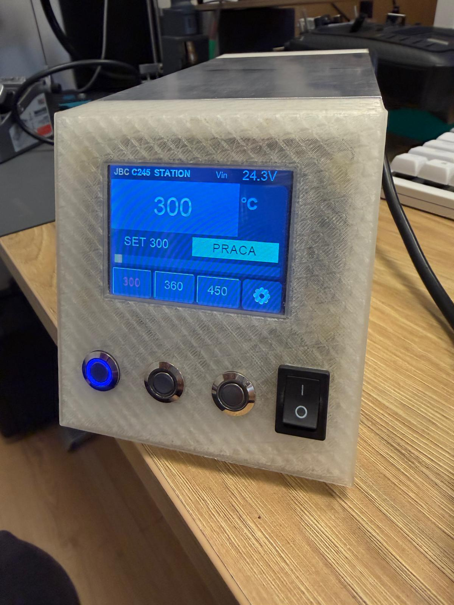
</p>

<p align="center">
  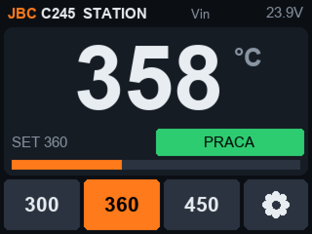
  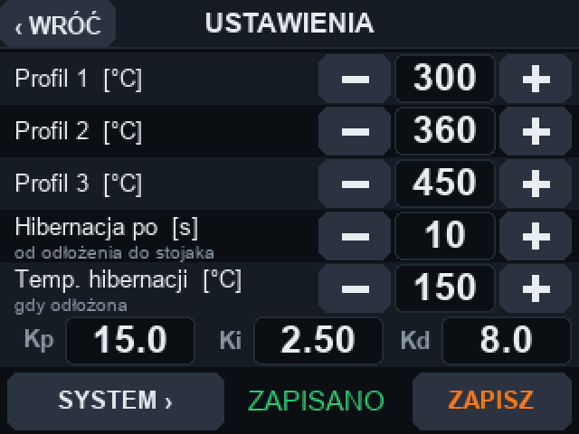
  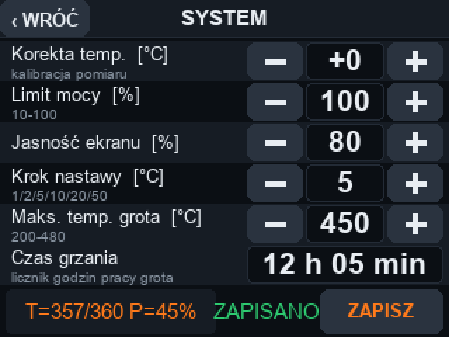
</p>

> **Status: complete and in daily use.** Heating, temperature control (±0.3 °C), the stand logic, tip change,
> supply monitoring and the touch UI are verified on real hardware – see [docs/STATUS.md](docs/STATUS.md).

---

## Contents

- [Photos](#photos)
- [Features](#features)
- [How it works](#how-it-works)
- [Hardware](#hardware)
- [Wiring](#wiring)
- [Getting started](#getting-started)
- [Using the station](#using-the-station)
- [Building the firmware](#building-the-firmware)
- [Repository layout](#repository-layout)
- [Troubleshooting](#troubleshooting)
- [Credits](#credits) · [Safety](#safety) · [License](#license)

---

## Photos

<table>
  <tr>
    <td width="50%" align="center">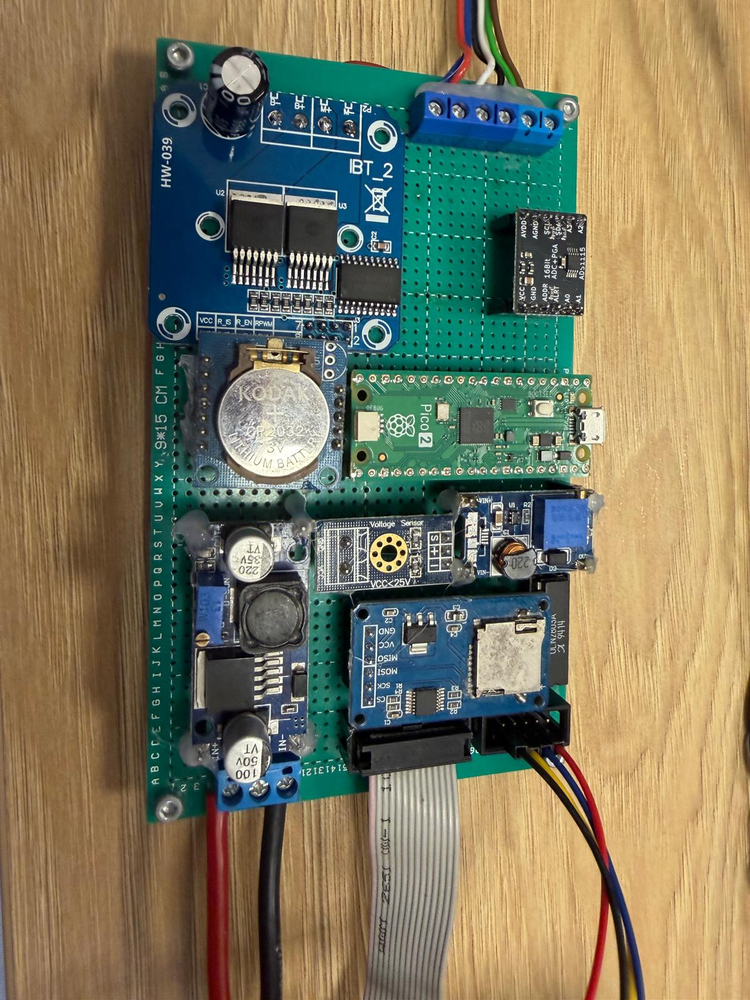<br><sub><b>Controller board</b> – Pico 2, BTS7960 (IBT-2), ADS1115, DC-DC converters, voltage sensor</sub></td>
    <td width="50%" align="center">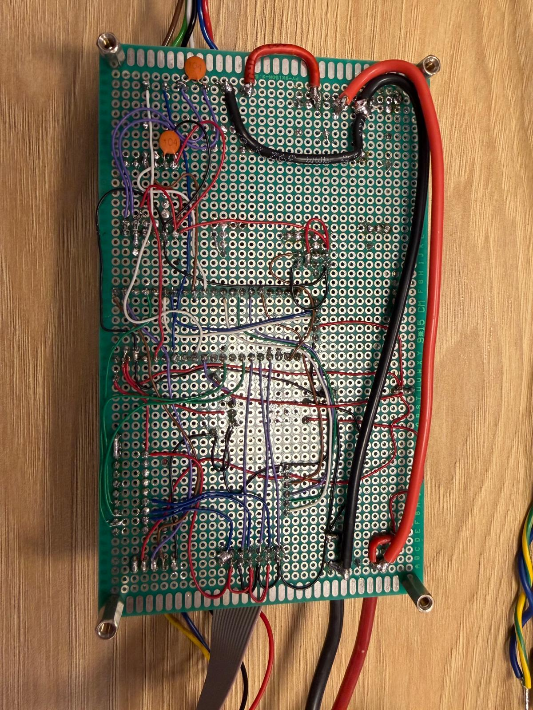<br><sub><b>Wiring side</b> – thick wires carry the heater current to the star ground point</sub></td>
  </tr>
  <tr>
    <td width="50%" align="center">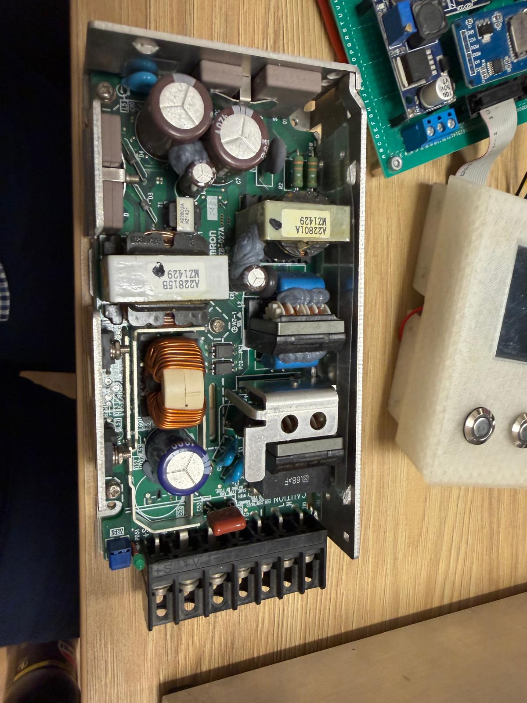<br><sub><b>24 V power supply</b> – Omron industrial PSU inside the case</sub></td>
    <td width="50%" align="center"><br><sub><b>At work</b> – holding 300 °C, supply 24.3 V</sub></td>
  </tr>
</table>

---

## Features

| | |
|---|---|
| 🔥 **Fast, stable heating** | PID control, about 2 s from 300 to 340 °C, holds the setpoint within ±0.3 °C |
| 🌡️ **Accurate measurement** | ADS1115 16-bit ADC, C245-specific thermocouple curve, cold-junction compensation |
| 🖐️ **Touch screen** | Nextion 2.8", three pages, look designed in Nextion Editor from generated backgrounds |
| 🔘 **Physical presets** | three buttons with LEDs, long press to switch the iron on/off |
| 💤 **Smart stand** | standby → hibernation → heating off after 15 min; lifting the iron wakes it at once |
| 🔧 **Tip-change contact** | heating blocked while the tip is being swapped |
| ⚙️ **System page** | temperature offset, power limit, brightness, setpoint step, max tip temperature, heating-time counter |
| 🛡️ **Protection** | missing tip, over-temperature, “heating but not rising”, watchdog |
| 💻 **USB console** | status, CSV logging, PID tuning, sensor and display diagnostics |
| ✌️ **Two irons ready** | pins and logic for a second iron are already in the firmware |

---

## How it works

### Block diagram

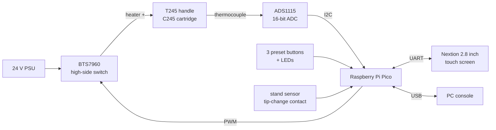

### The C245 cartridge

A JBC C245 cartridge has three contacts. The heater (≈ 3 Ω) and the thermocouple (≈ 0.4 Ω) are in series
and **share one common wire**. Two things follow from this:

1. **The common wire must sit permanently on ground**, and the heater has to be switched on the
   **positive** side. That is why the station uses a BTS7960 high-side switch – an ordinary low-side
   MOSFET module either leaves the heater on all the time or puts 24 V on the measurement input.
2. **Temperature can only be measured while the heater is off.** While heater current flows, the voltage
   drop on the shared wire is thousands of times larger than the thermocouple signal.

### Heat / measure cycle

The firmware runs a fixed 370 ms cycle:

```
|<------------- heating 350 ms ------------->|<- 10 ms ->|<- 10 ms ->|
|  heater PWM = PID output                   |  settle   |  measure  |  → PID → next cycle
```

1. **Heating** – the heater is driven with 1 kHz PWM at the duty calculated by the PID.
2. **Settle** – the heater is switched off and the switch pulls the heater to ground, so both cartridge
   wires sit at 0 V.
3. **Measure** – the ADS1115 takes one differential reading of the thermocouple (≈ 8 ms).
4. **Regulate** – the PID calculates the power for the next window.

The measuring gap is only 20 ms, so up to ~94 % of the heater power is available.

### Temperature measurement

- The thermocouple is read **differentially** (A0–A1) on the ±0.256 V range: 7.8 µV per step.
- The C245 thermocouple is **not type K** – it gives about 28 µV/°C (≈ 9.2 mV at 350 °C).
  The firmware uses the curve measured by the [AxxSolder](https://github.com/AxxAxx/AxxSolder) project.
- A thermocouple only measures the difference between the tip and its cold end. The cold-end temperature
  comes from the Pico's internal sensor (an NTC on the ADS1115 A2 input is supported as an option).
- A 1 MΩ resistor pulls the green wire up: with the tip removed the input jumps to full scale and the
  station shows *BRAK KOLBY* (no tip).

### PID control

- Output 0–100 % of the heating window, limited by the power limit from the system page.
- The integral only works within ±10 °C of the setpoint, so it does not wind up during warm-up.
- The derivative is calculated from the measurement, so changing the setpoint does not cause a power spike.
- Default gains Kp = 15, Ki = 2.5, Kd = 14 – tuned on a real cartridge: 200 → 300 °C without overshoot,
  300 → 380 °C within +3 °C, then ±0.3 °C; tunable from the USB console.

### Iron modes and the stand

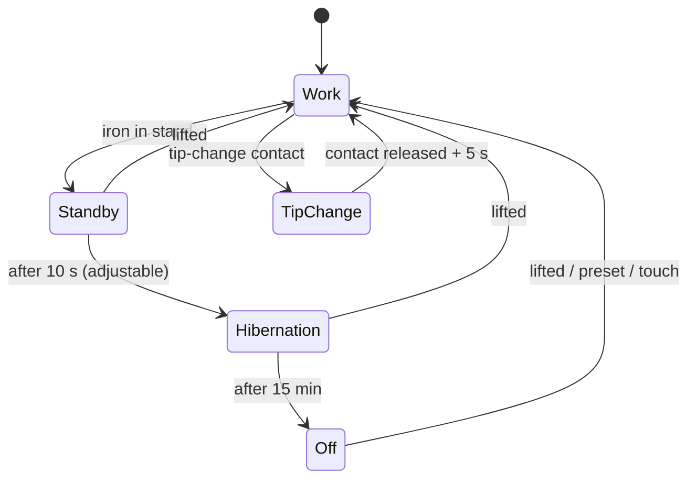

| Mode (on-screen) | Meaning | Temperature |
|---|---|---|
| PRACA | work | setpoint |
| CZUWANIE | standby, iron in the stand | setpoint |
| HIBERNACJA | hibernation | hibernation temperature (150 °C) |
| WYLACZONA | off | heater off |
| WYM. GROTU | tip change | heater off |

An iron switched off by the user stays off when lifted – it waits for a preset button or a touch.

### Protection

| Situation | Reaction |
|---|---|
| tip missing / thermocouple open | heater off, *BRAK KOLBY*, resumes automatically |
| temperature above 520 °C | heater off, *PRZEGRZANIE*, latched until cooled down |
| ≥ 80 % power for 15 s and the temperature rises less than 15 °C | heater off, *BLAD GRZANIA* (heater, wiring or supply problem) |
| firmware hang | watchdog restarts the Pico within 2 s, heater switch drops to off |

### Touch screen architecture

The look of the screen lives entirely in **Nextion Editor** – backgrounds, fonts, photos, layout.
The Pico only:

- writes values and state colours into components **by name** (e.g. `t_cur1.txt="358"`),
- switches pages,
- receives button presses – every button sends one line: `printh 65 <page> <id> 01`.

This keeps the UI fully customisable without touching the firmware. The backgrounds in
`display/ui_1kolba/` are generated by `firmware/tools/gen_nextion_ui.py`; every button and field is
transparent (*crop image*) and shows the matching part of a normal or a pressed background.
Full component list: [docs/DISPLAY.md](docs/DISPLAY.md).

---

## Hardware

| Part | Notes |
|---|---|
| Raspberry Pi Pico or Pico 2 | same pinout; separate `.uf2` for each; not the W versions |
| JBC T245 handle + C245 cartridges | heater ≈ 3 Ω, thermocouple ≈ 0.4 Ω |
| ADS1115 module | 16-bit ADC, I2C |
| BTS7960 module (IBT-2) | 43 A half bridge, used as a high-side switch |
| Nextion NX3224T028 / K028 | 2.8", 320×240, resistive touch |
| 24 V power supply | at least 150 W (an Omron industrial PSU in this build) |
| Voltage sensor module | measures the 24 V input on GP26; overall ratio set by `V_DIVIDER_RATIO` in `config.h` – GP26 must stay below 3.3 V |
| DC-DC converter #1 | 24 V → 5 V for the Pico (VSYS), the Nextion and the modules |
| DC-DC converter #2 + ULN2803A | supply and low-side driver for the button LEDs (Pico pins drive the ULN inputs) |
| 3 push buttons with LEDs | presets |
| Stand with a contact | closes to GND when the iron is in the stand |
| 2 × 2.2 kΩ, 1 × 1 MΩ, 100 nF | thermocouple input protection, filter and missing-tip detection |
| 2 × BAT54S (optional) | clamp diodes on A0 / A1 |
| RTC module, microSD module | spare modules on the board, not used by the firmware |

---

## Wiring

### Iron (T245 handle)

| Handle wire | Function | Connect to |
|---|---|---|
| red | common (heater − / thermocouple) | star ground point and, via 2.2 kΩ, ADS1115 A1 |
| green | thermocouple (marked EARTH / SENSE B) | via 2.2 kΩ to ADS1115 A0 **only** |
| blue | heater + | BTS7960 M+ |

```
 3.3 V ──[1 MΩ]──┐
                 │
 green ──────────┴──[2.2 kΩ]──┬────── A0  (ADS1115)
                              │
                            ═════ 100 nF
                              │
 red (at socket) ───[2.2 kΩ]──┴────── A1  (ADS1115)

 red ════════════════════════════════ star ground point (thick wire)
```

- **The 1 MΩ pull-up goes on the iron side of the 2.2 kΩ resistor.** On the ADS side its 3.3 µA would
  drop 7 mV across the 2.2 kΩ resistor, which looks like ~260 °C and the tip is never detected.
- The 2.2 kΩ resistors limit the current into the ADS1115 to ~10 mA if 24 V ever reaches the
  thermocouple wire (e.g. a loose common wire while heating). They lower the reading by about 0.6 %
  (≈ 2 °C at 350 °C) – correct it with the offset on the system page.
- Optional extra protection: a BAT54S on A0 and on A1 (middle pin to the signal, the outer pins to
  3.3 V and GND).
- Take A1 with its own thin wire right at the handle socket – heater current causes a voltage drop on the
  ground wire.

### Grounding

Two ADS1115 modules were lost before the station had a proper common ground. All grounds meet in
**one point**, connected with thick wires:

```
 24 V PSU −  ──┐
 BTS7960 B−  ──┤
 iron red    ──┼──  star ground point
 Pico GND    ──┤
 ADS1115 GND ──┘
```

Before connecting the ADS1115 to a station powered from 24 V for the first time, measure the green wire
against the ground point while heating at low power – it must stay within a few millivolts.
- In the C245 the green wire is **negative** relative to the red one. The firmware handles this
  (`ADS_TC_INVERT 1` in `config.h`).

### ADS1115

| ADS1115 | Connect to |
|---|---|
| VDD | Pico 3.3 V – **not 5 V**, the module pulls SDA/SCL up to its supply |
| GND | GND |
| SDA / SCL | GP6 / GP7 (I2C1) |
| ADDR | GND or unconnected – the firmware scans 0x48–0x4B |

### BTS7960 (IBT-2)

| BTS7960 | Connect to |
|---|---|
| B+ / B− | +24 V / GND (wire ≥ 0.75 mm²) |
| M+ | blue wire (heater +) |
| M− | **not connected** |
| RPWM | GP17 |
| LPWM | GND |
| R_EN, L_EN, VCC | Pico 3.3 V |
| GND | Pico GND |
| R_IS, L_IS | not connected |

### Raspberry Pi Pico pins

| Pin | GPIO | Function |
|---:|---|---|
| 1 / 2 | GP0 / GP1 | UART to Nextion: TX → display RX, RX ← display TX |
| 9 / 10 | GP6 / GP7 | ADS1115 SDA / SCL (I2C1) |
| 22 | GP17 | heater PWM → BTS7960 RPWM |
| 24 / 25 / 26 | GP18 / GP19 / GP20 | preset buttons 1 / 2 / 3 (to GND) |
| 27 / 29 / 4 | GP21 / GP22 / GP2 | LEDs of buttons 1 / 2 / 3 |
| 32 | GP27 | stand sensor (to GND = iron in the stand) |
| 34 | GP28 | tip-change contact (to GND = active) |
| 31 | GP26 | supply voltage (ADC0, from the voltage sensor module) |
| 21, 5 | GP16, GP3 | iron 2: heater, stand (thermocouple on ADS1115 A2–A3) |

All pins are defined in [`firmware/src/config.h`](firmware/src/config.h).

### Wiring diagram

<p align="center">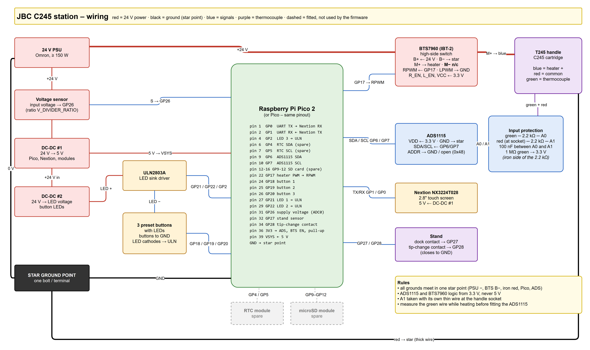</p>

Source: [`docs/wiring_diagram.drawio`](docs/wiring_diagram.drawio) – open it in [draw.io](https://www.drawio.com/),
or regenerate it with `python docs/gen_wiring_drawio.py`.

---

## Getting started

1. **Flash the display.** Open `display/jkb_nextion.HMI` in Nextion Editor → *Compile* →
   *File → TFT file output*. Copy the `.tft` as the only file onto a FAT32 microSD card, insert it into
   the display and power it up. After *Update successed* remove the card and restart.
2. **Flash the Pico.** Hold **BOOTSEL**, plug in USB and copy the file to the drive that appears:
   - Pico (RP2040): [`firmware/bin/jbc_station_v2.3.1_1kolba.uf2`](firmware/bin/) → `RPI-RP2`,
   - Pico 2 (RP2350): [`firmware/bin/jbc_station_v2.3.1_1kolba_pico2.uf2`](firmware/bin/) → `RP2350`.
   The on-board LED starts blinking once per second.
3. **Check without 24 V.** Open a serial terminal on the Pico COM port (115200 baud):
   - `status` – iron state and `nextion=OK`,
   - `tc` – ADS1115 address and thermocouple voltage,
   - `i2c` – I2C line test and address scan if the ADS1115 is not found,
   - tip removed → `NOTIP`; tip warmed from outside → the temperature rises.
4. **First heating.** Connect 24 V, type `log on`, choose a low setpoint (e.g. 200 °C) and watch the log.
5. **Calibrate** (optional) with a tip thermometer and set the offset on the system page.

---

## Using the station

### Screen

| Page | What is there |
|---|---|
| **Main** | big tip temperature, setpoint, mode field, power bar, three preset buttons, settings button. Touching the mode field turns the iron on/off. |
| **Settings** | preset temperatures, time to hibernation, hibernation temperature, PID preview |
| **System** | temperature offset, power limit, brightness, setpoint step, max tip temperature, heating-time counter, live temperature/power |

Temperature colour: white = at setpoint, orange = heating, blue = cooling, red = fault, grey = off.
On-screen texts are in Polish.

### Buttons and LEDs

| Action | Result |
|---|---|
| short press of button 1 / 2 / 3 | select preset 1 / 2 / 3 |
| long press of button 3 | iron on / off |
| button LED on | active preset |
| button LED slow blink | standby / hibernation |
| all LEDs fast blink | fault |
| Pico on-board LED | 1 Hz = running, 4 Hz = fault |

### Settings and defaults

| Setting | Range | Default |
|---|---|---|
| presets 1 / 2 / 3 | 150 °C – max temperature | 300 / 360 / 450 °C |
| time to hibernation | 5–300 s | 10 s |
| hibernation temperature | 50–250 °C | 150 °C |
| heating off after hibernation | 0–120 min (0 = never) | 15 min |
| temperature offset | ±50 °C | 0 |
| power limit | 10–100 % | 100 % |
| setpoint step | 1, 2, 5, 10, 20, 50 °C | 5 °C |
| max tip temperature | 200–480 °C | 450 °C |

Settings are saved to flash automatically 20 s after the last change, or at once with *ZAPISZ* (save).

### USB console (115200 baud)

```
help                  list of commands
status                iron state, settings, display link
log on | log off      CSV per measurement: ms,ch,temp,target,duty,mode
set 1 350             setpoint of iron 1
pid 1 15 2.5 8        PID gains of iron 1
offset 1 -5           temperature offset of iron 1
aoff 15               heating off after 15 min of hibernation (0 = never)
on 1 | off 1          iron on / off
save                  save settings to flash
defaults              factory settings (heating-time counter is kept)
tc                    thermocouple / ADS1115 diagnostics
i2c                   I2C line test and address scan
nx                    display link diagnostics
```

More details: [docs/FIRMWARE.md](docs/FIRMWARE.md).

---

## Building the firmware

Requirements: [Pico SDK 1.5.1](https://github.com/raspberrypi/pico-setup-windows) (Windows installer).
In the *Pico – Developer Command Prompt*:

```bat
cd firmware
mkdir build && cd build
cmake .. -G Ninja
ninja
```

Output: `firmware/build/jbc_station.uf2`.

**Pico 2 (RP2350)** needs [Pico SDK 2.1.1](https://github.com/raspberrypi/pico-sdk) and
[picotool 2.1.1](https://github.com/raspberrypi/pico-sdk-tools/releases) (the compiler from the 1.5.1
installer works):

```bat
set PICO_SDK_PATH=C:\path\to\pico-sdk-2.1.1
cmake -S firmware -B firmware/build_pico2 -G Ninja -DPICO_BOARD=pico2 -DPICO_PLATFORM=rp2350-arm-s -Dpicotool_DIR=C:\path\to\picotool
ninja -C firmware/build_pico2
```

Key options in [`firmware/src/config.h`](firmware/src/config.h):

| Option | Meaning |
|---|---|
| `NUM_CHANNELS` | 1 or 2 irons |
| `TEMP_SENSOR` | `TEMP_SENSOR_ADS1115` (default) or the legacy `TEMP_SENSOR_MAX6675` |
| `ADS_TC_INVERT` | thermocouple polarity |
| `CJC_SOURCE` | cold junction: Pico internal sensor or NTC on A2 |
| `PIN_*` | all pin assignments |

Screen backgrounds (Python 3 + `pip install pillow`):

```bat
python firmware/tools/gen_nextion_ui.py
```

---

## Repository layout

```
├── firmware/              Raspberry Pi Pico / Pico 2 firmware (C, Pico SDK 1.5.1 / 2.1.1)
│   ├── src/               source code – pins and constants in config.h
│   ├── tools/             screen background generator (Python + Pillow)
│   ├── bin/               ready-to-flash .uf2
│   └── CMakeLists.txt
├── display/               Nextion project (.HMI), compiled .tft, fonts
│   └── ui_1kolba/         backgrounds, previews, name maps, component table
├── enclosure/             3D model of the case (SolidWorks, STL)
├── docs/
│   ├── FIRMWARE.md        firmware internals
│   ├── DISPLAY.md         building the Nextion project
│   ├── STATUS.md          features and hardware verification
│   └── images/            photos used in this README
└── CHANGELOG.md
```

### Enclosure

<p align="center">
  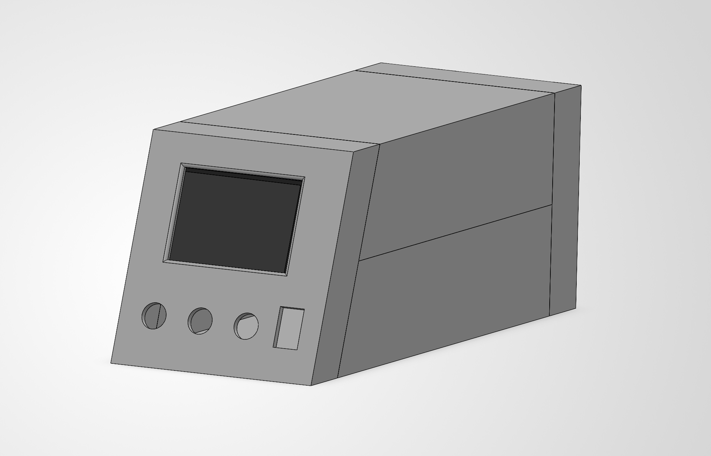
</p>

<table>
  <tr>
    <td width="50%" align="center">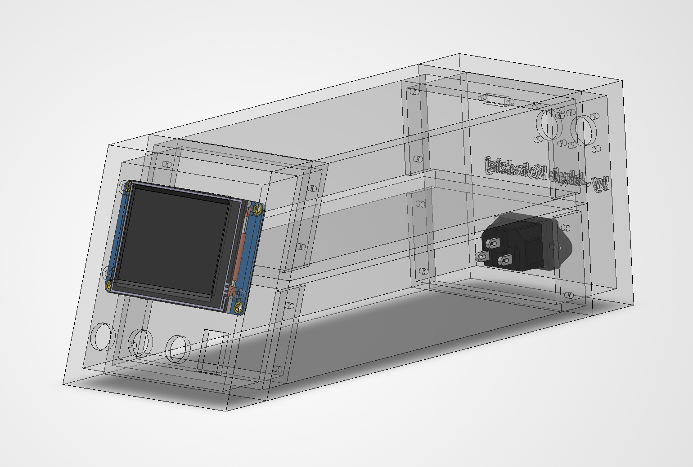<br><sub><b>Front, see-through</b> – Nextion 2.8" behind the front panel, buttons and power switch below</sub></td>
    <td width="50%" align="center">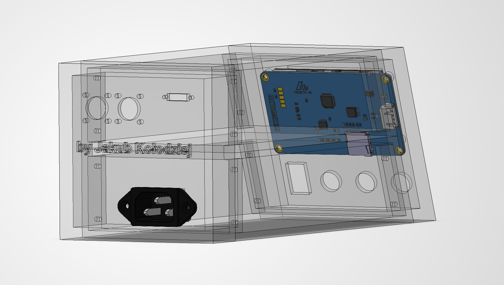<br><sub><b>Rear, see-through</b> – IEC mains socket in the back panel</sub></td>
  </tr>
</table>

The case is 3D-printed in four parts. The SolidWorks assembly and printable STL parts are in [`enclosure/`](enclosure/README.md).

---

## Troubleshooting

| Symptom | Likely cause |
|---|---|
| temperature stuck near room temperature, also with the tip removed | thermocouple input shorted, or the iron's common wire not on ground |
| temperature falls while heating | thermocouple polarity – toggle `ADS_TC_INVERT` |
| *BRAK KOLBY* with the tip in place | 1 MΩ pull-up fitted on the ADS side of the 2.2 kΩ resistor, or ADS1115 not found (`tc`, `i2c`) |
| `i2c` finds no device | SDA/SCL swapped, ADS1115 not powered from 3.3 V, or the chip is damaged |
| ADS1115 gets hot / stops answering while heating | voltage on the thermocouple input: no common ground or a loose red wire – see [Grounding](#grounding) |
| *BLAD GRZANIA* right after start | no 24 V, heater wire not connected, or BTS7960 not enabled (R_EN/L_EN) |
| heater always on | a low-side switch is used, or M− is connected – see [Wiring](#wiring) |
| `status` shows `nextion=brak odp.` | display TX not reaching GP1, or no common ground |
| screen buttons do nothing | code in *Touch Release* instead of *Touch Press*, or wrong page byte in `printh` |
| a screen field stays empty | wrong component name, missing font or `txt_maxl` too small – see [docs/DISPLAY.md](docs/DISPLAY.md) |

---

## Credits

- The C245 thermocouple curve coefficients (ΔT = 0.035747·U − 4.1975·10⁻⁸·U², U in µV) are taken from
  [AxxSolder](https://github.com/AxxAxx/AxxSolder) by AxxAxx, who measured them on real C245 cartridges.
  Everything else – firmware, display, enclosure and documentation – is original work.
- JBC, T245 and C245 are trademarks of JBC Soldering S.L. This project is not affiliated with JBC.

## Safety

The tip reaches over 450 °C and the power supply delivers about 8 A. Build and test carefully,
do the first runs under supervision and never leave the station switched on unattended.
You build and use this project at your own risk.

## License

[](LICENSE)

Copyright © 2026 Jakub Kołodziej ([iikolodziej](https://github.com/iikolodziej))

This project – firmware, display project, enclosure models and documentation – is free software:
you can redistribute it and/or modify it under the terms of the
[GNU General Public License v3.0](https://www.gnu.org/licenses/gpl-3.0) as published by the Free Software
Foundation. See [LICENSE](LICENSE).

It is distributed in the hope that it will be useful, but **without any warranty**.
